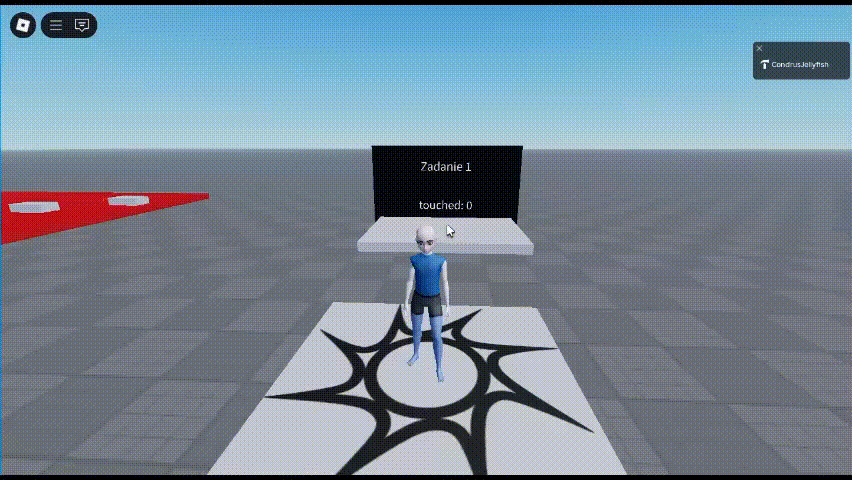
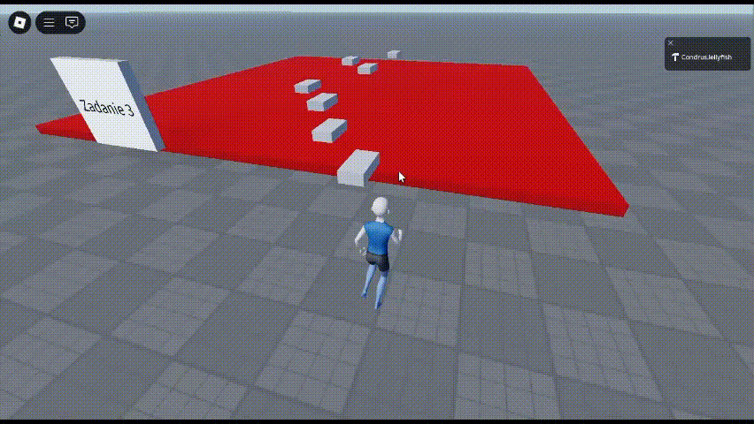

# Roblox Feature Pack (Test Assignment)

A set of gameplay mechanics implemented in Roblox Studio (Lua) as part of a test assignment.

---

## Review Without Studio

The original place file is [Testovoe.rbxl](Testovoe.rbxl). Its 8 embedded scripts have also been extracted into [src/](src/) without altering the place. The [manifest](src/manifest.json) records the original instance paths and enabled/disabled states. Open the `.rbxl` file in Roblox Studio to play; the extracted files are for reading and are not a standalone game.

## How to Review the Project
- The scripts for each task are placed in separate folders or services.
- The final versions are enabled by default and combine all required points.
- If needed, you can enable separate variants as well, for example `Zadanie1.1` or `Zadanie3.1-3.2`, and they also work correctly.

---

## Task 1 - Counter and Teleports
**Requirements:**
1. The counter increases only the first time a player steps on the tile.
2. If the player stays on the platform for 2 seconds, they are teleported to `SpawnLocation`.
3. Every 5th teleport is replaced with the player's death.

**Implementation:**
- Scripts `Zadanie1.1`, `Zadanie1.2`, and the final `Zadanie1.3` are located in *ServerScriptService*.
- `Zadanie1.3` is enabled by default.
- To avoid `Touched/TouchEnded` bugs where each body part fires a separate event, a more reliable counter-and-flags approach was used.

---

## Task 2 - GUI + Saves
**Requirements:**
1. The GUI should look at least minimally polished.
2. Every 20th click kills the player, and the logic must run on the server.
3. The counter should be saved and restored when the player rejoins.

**Implementation:**
- The local script `Zadanie2` is located in *StarterPlayerScripts*.
- `RemoteEvent` in *ReplicatedStorage* is used for client-server communication.
- The server logic (`Zadanie2`) is in *ServerScriptService*: it receives events, processes them, and saves / loads clicks through DataStore.
- The score counting on the client side is left as in the original template, but the README notes that doing it on the server would be more correct.

---

## Task 3 - KillBlock + Checkpoints
**Requirements:**
1. The red platform kills the player.
2. The white platforms work as checkpoints.
3. When a new checkpoint is activated, the previous one disappears; when all are gone, they appear again.

**Implementation:**
- All scripts are placed in the *Zadanie3* folder.
- A simple version (`Zadanie 3.1-3.2`) exists separately but is disabled.
- The full version, `Zadanie 3 (polnostyu)`, is implemented using **checkpoint tags**.

---

## Task 4 - Tweening and Object Animation
**Requirements:**
1. The `mover` object must move between `pos1` and `pos2`.
2. The `spiner` object rotates around the vertical axis.

**Implementation:**
- Script `Zadanie4` is stored in the *Zadanie4* folder.
- Movement is implemented through TweenService.
- Rotation is implemented with `PivotTo` and coroutines.

---

## Scope and Known Limitations

This repository preserves an earlier test assignment, including the original implementation choices. In Task 2, the client counts clicks and requests death, while the server accepts the submitted counter. This is not a server-authoritative or exploit-resistant click system. The initial GUI can also race the first saved-data response. A future revision should move counting and milestone decisions to the server and synchronize the initial GUI state.

## Result
The four assignment areas are represented in the original place and recordings.
These tasks demonstrate my level of confidence with key Roblox mechanics:

- DataStore for saving and loading data
- checkpoints and kill blocks
- GUI and RemoteEvents
- TweenService and Pivot for animations
- code organization and debugging of non-trivial `Touched/TouchEnded` cases

This is only a small part of what I can build in Roblox Studio, from inventories and NPC logic to more advanced prototypes and learning-oriented gameplay scenarios.
