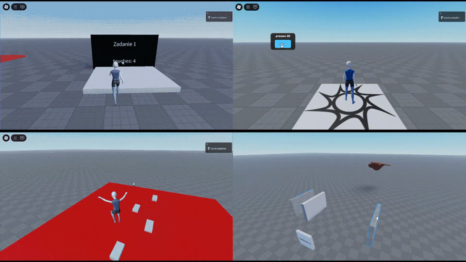
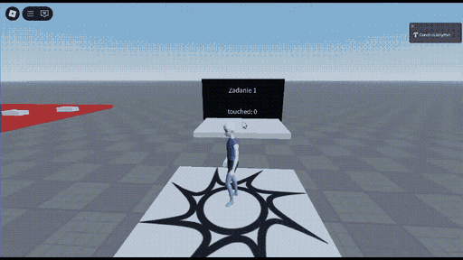
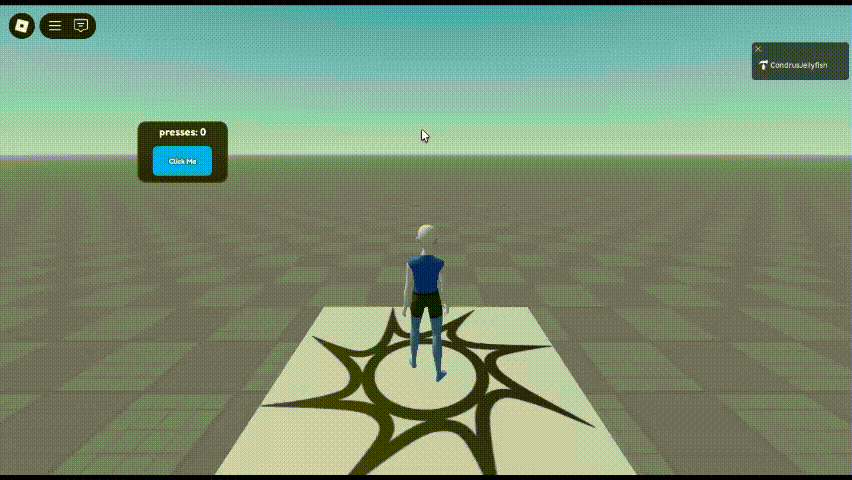
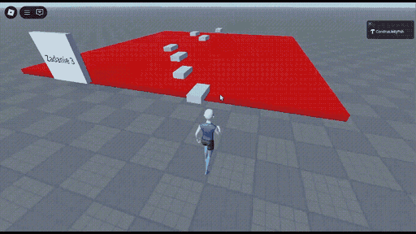
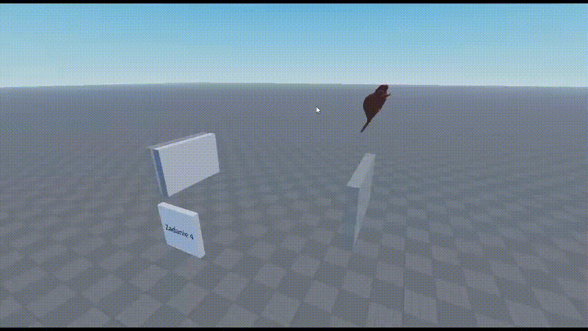

# Roblox Feature Pack

A Roblox fundamentals test assignment: four small gameplay tasks (pressure plate, GUI clicker with saves, kill parts and checkpoints, tweening), refactored into a Rojo project with server-authoritative logic, strict Luau, unit tests and CI.



**Stack:** Luau (`--!strict`), Rojo, Roblox Studio, Selene, StyLua, Lune (tests and build script), luau-lsp (type check), GitHub Actions.

## What the assignment asked and what was built

The recordings below show the original submission. The code has since been refactored (see [Architecture and security](#architecture-and-security)) and has not been re-recorded yet.

### Task 1: pressure plate

**Asked:** count a player's step onto the plate once per visit (not while walking on it); after 2 seconds on the plate, teleport the player to `SpawnLocation`; every 5th teleport kills the player instead.

**Built:** [`Task1_PressurePlate.server.luau`](src/server/Task1_PressurePlate.server.luau) polls each character's root position in the plate's object space ten times per second instead of relying on `Touched`/`TouchEnded`, which fire per body part and flicker while walking. The rules (enter, stand timer, every 5th trigger) live in a pure module, [`PressurePlate.luau`](src/shared/PressurePlate.luau), covered by unit tests. Each player's count is a player attribute, and [`Task1_PlateLabel.client.luau`](src/client/Task1_PlateLabel.client.luau) shows the local player's own number on the sign.



### Task 2: GUI clicker with saves

**Asked:** a minimally polished GUI button; every 20th click kills the player, with the logic on the server; the count persists between sessions.

**Built:** the client ([`Task2_ClickGui.client.luau`](src/client/Task2_ClickGui.client.luau)) only fires `ClickRequest` with no payload. The server ([`Task2_ClickCounter.server.luau`](src/server/Task2_ClickCounter.server.luau)) rate-limits requests per player, ignores dead players, increments the count, kills on every 20th click, and replicates the value through a player attribute. Data is loaded with retries and saved with `UpdateAsync` on leave, every 60 seconds and in `BindToClose`.



### Task 3: kill parts and checkpoints

**Asked:** the red floor kills on touch; white platforms are checkpoints; activating a new checkpoint hides the previous one, and when they are all gone they reappear.

**Built:** [`Task3_Checkpoints.server.luau`](src/server/Task3_Checkpoints.server.luau) uses CollectionService tags (`killparts`, `checkpoints`) already present in the map. Checkpoint progress is per player: the server keeps each player's state, respawns them at their last checkpoint and refuses touches on checkpoints that are hidden for them. [`Task3_CheckpointVisibility.client.luau`](src/client/Task3_CheckpointVisibility.client.luau) hides the used checkpoints only for that player, so two players can be at different stages.



### Task 4: tweening and rotation

**Asked:** `mover` travels between `pos1` and `pos2`; `spiner` rotates around its vertical axis.

**Built:** [`Task4_Motion.server.luau`](src/server/Task4_Motion.server.luau) plays one reversing, endlessly repeating tween for the mover and rotates the spinner around the vertical axis through its pivot on `Heartbeat`, scaled by delta time so the speed does not depend on frame rate.



## Architecture and security

```
src/
  shared/   ReplicatedStorage.Shared   Config + pure rule modules (no Roblox APIs, unit-tested)
  server/   ServerScriptService.Server one Script per task
  client/   StarterPlayerScripts.Client presentation only: labels, GUI, local visibility
tests/      Lune unit tests for src/shared
scripts/    build-place.luau: map + code -> build/FeaturePack.rbxl
```

- **The server owns every decision.** Clients send intent (`ClickRequest` has no arguments) and render state from player attributes. A modified client cannot set its own click count, skip the 20-click rule or fire a kill request directly (the old `KillEvent` and `ClickEvent(count)` remotes are gone).
- **Rate limiting.** A per-player token bucket (burst 10, 8 clicks per second) caps autoclickers. Values are in [`Config.luau`](src/shared/Config.luau).
- **No GUI/data race.** The count is a player attribute, so the GUI reads the current value whenever it (re)spawns and shows "loading..." until the server has loaded data.
- **Safe saves.** `GetAsync`/`UpdateAsync` are wrapped in `pcall` with retries and backoff. If loading fails, the session is not saved, so a DataStore outage cannot reset someone's progress to 0. `UpdateAsync` refuses to overwrite a higher stored value from a stale session. The key format matches the original version, so existing saves still load.
- **Per-player state everywhere.** Touch counts, teleport counters and checkpoint progress are stored per player and cleaned up on `PlayerRemoving`.
- **Streaming-aware client code.** The place has streaming enabled, so client scripts use `WaitForChild` and CollectionService signals instead of assuming parts exist.

Not covered on purpose (test-assignment scope): DataStore session locking across servers, and moving the spinner to the client with atomic model streaming to save bandwidth.

## How to run

Tools are pinned in [`rokit.toml`](rokit.toml). With [Rokit](https://github.com/rojo-rbx/rokit) installed:

```sh
rokit install
lune run scripts/build-place     # builds build/FeaturePack.rbxl
rojo serve                       # optional: live sync while editing
```

1. Open `build/FeaturePack.rbxl` in Roblox Studio and press Play.
2. For live editing, install the Rojo Studio plugin, run `rojo serve` and click Connect.
3. Saves in Studio need a published place with **Game Settings > Security > Enable Studio Access to API Services**. Without it the game still runs, and the server logs that clicks will not persist.

`Testovoe.rbxl` is the original place and is used as the map. It still contains the original submission's scripts; the build script removes them so they do not run next to the Rojo code. Map instance names (`zadanie1`, `Zadanie 3`, `Zadanie4`, `Zadanie2`) come from the assignment template and are referenced from `Config.luau`.

Checks (the same as CI):

```sh
stylua --check src tests scripts
selene src
lune run tests/run
rojo sourcemap default.project.json -o sourcemap.json
luau-lsp analyze --sourcemap=sourcemap.json --definitions=globalTypes.d.luau src
```

## AI-assisted workflow

The original assignment was scripted by hand in Roblox Studio. This refactor (Rojo layout, exploit fixes, tests and CI) was done with an AI coding assistant under my direction; the gameplay rules follow the original assignment.

## Next steps

- Re-record the GIFs from the refactored build and add a two-player test of checkpoints.
- Move spinner rotation to the client with `ModelStreamingMode = Atomic`.
- Add session locking (or ProfileStore) if the click counter becomes real progression data.
